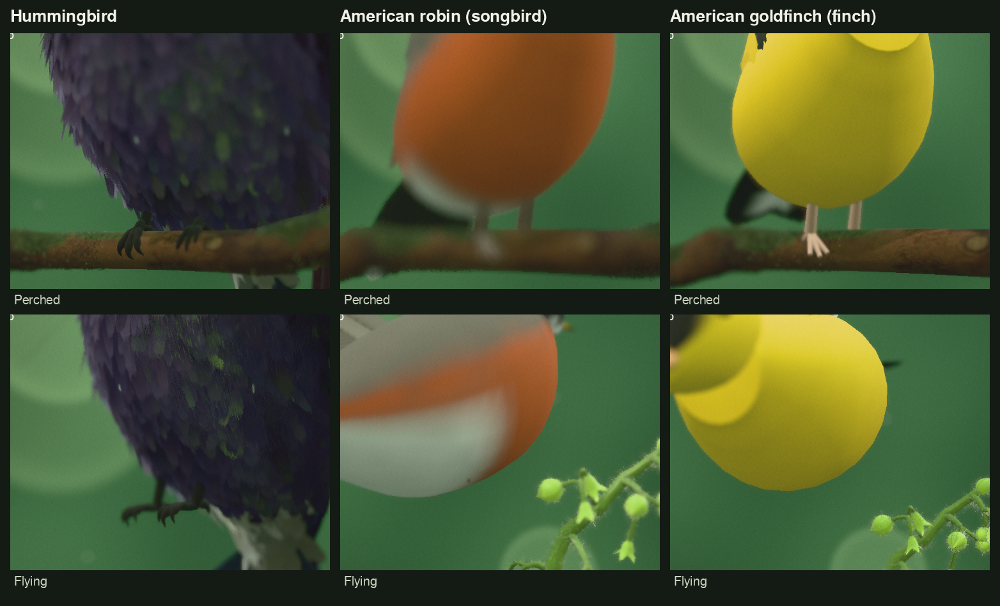
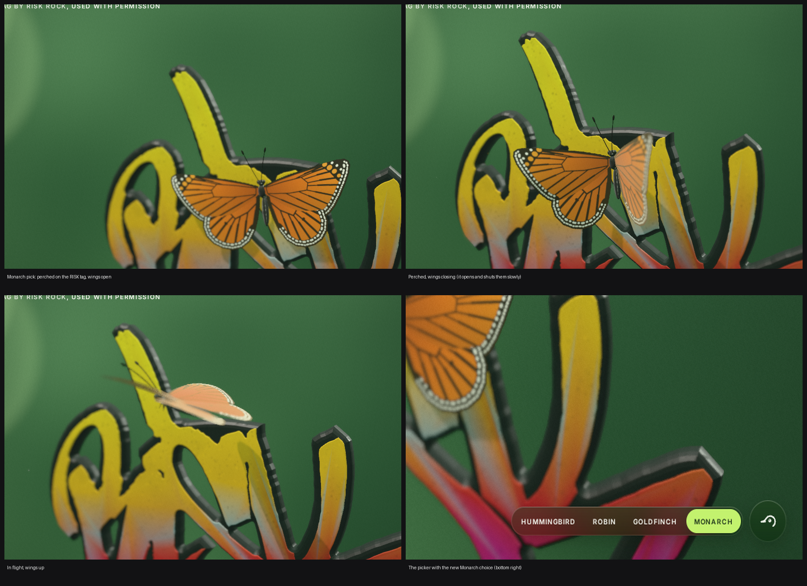

# Hummingbird, robin and goldfinch on Risk Rock's RISK tag

A real-time Three.js bird scene in one offline HTML file. Open `index.html`, or the live page:

https://allowistic.github.io/hummingbird-scene/

## What's in it

- **Hummingbird** (purple-throated mountain-gem): Theo Tillberg's rigged, feathered hummingbird. It now flies a tour round the scene every so often: it darts to three to five points round the tag, hovers at each with its wings a blur, then comes back and lands.
- **American robin** (the songbird): drawn with the hummingbird's own feather system, so it has the same layered contour feathers, soft fuzz, separate primaries and secondaries that fan and fold, tail feathers, glossy eyes and lighting. Grey-brown back, orange-red breast, near-black head, white eye ring and streaked white throat, yellow bill. Steady flaps with short glides, hops along the tag, looks about, flicks its tail and sings.
- **American goldfinch** (the finch): same feather system. Bright yellow body, black cap, black wings with two white wing bars and a yellow shoulder, short pale bill. The finch's bounding flight, a burst of flaps then wings shut, rising and dipping. Hops, sings and flicks its tail too.
- **The perch: Risk Rock's RISK tag.** The twig is replaced by Risk Rock's RISK tag cut as a free-standing sculpture: the black outline-and-shadow piece is the body, thick with a fully rounded edge, and the letters sit raised on both faces, sprayed in the tag's yellow-to-red-to-purple fade with a cyan cut-through and a matte overspray grain. The top of the S is evened out into a smooth rail the birds stand on, with the same rail radius the twig had, so their feet wrap it. It's solid, so it no longer bends under the bird.
- **Monarch butterfly**: an ambient extra beside whichever bird is showing, modeled and painted in code. Orange cells, black veins, the black border with two rows of white spots, the black forewing tip with its orange and white spots, the paler underside, a soft scale sheen, a spotted black body under a few shells of fuzz, clubbed antennae. It flies the way monarchs do (a few deep flaps, a glide on raised wings, a wandering path), keeps clear of the bird and the tag, and every so often lands on the top of a letter and slowly opens and closes its wings. Toggle it in the settings card ("Monarch butterfly") or with the M key. In performance mode its fuzz is off. About 6k triangles.
- **Bird picker** (bottom right, next to the menu): Hummingbird, Robin, Goldfinch, Monarch. It swaps the bird on screen and its voice together.
- **Monarch pick (no bird)**: no bird is shown and the monarch is the subject, about two and a half times life size, with the camera leaning in and following it. It wanders in front of the tag, lands on the tag's front face with its back to you, and basks, slowly opening and closing its wings. F sends it off the tag. Its sound is a quiet garden: a soft wing flutter while it flies over a low breeze, no song. "Butterfly size (Monarch pick)" in the settings scales it from 1x to 4x. Picking a bird again brings the small ambient monarch back, still toggled by M and the settings switch. Its wing textures are 1024 px with drawn scale strokes, its wings and body have more geometry and a fourth fuzz shell, and the wing edges are anti-aliased, so it holds up close: about 12k triangles.
- **Butterfly style: Risky (painted) or Real**: a switch in the settings card. **Risky** (the default) paints the monarch the way Risk Rock paints his: a stencil-and-spray piece with crisp bold black outlines and thick veins, the black border and wingtips filled with soft white spray dots in two or three rows (a few tinted pale pink or pale blue), the orange cells sprayed as fades from deep red-orange at the edges through warm yellow to a creamy glow by the body, a fine speckled overspray grain and a little pearl sheen, and a black stencil body with a white highlight and no fuzz. Colours were sampled from photos of his painted butterflies. **Real** is the realistic monarch from before. The switch covers both the small ambient monarch and the large Monarch pick, and the choice is remembered. `?mstyle=real` or `?mstyle=risky` overrides it. Only the style showing is painted at load.
- **Sound**: the music note in the bird menu (or the S key) turns synthesized bird sound on and off. Made with Web Audio in the page, no audio files.
- The settings card still has animation speed, time of day, slow camera drift and performance mode, and pause works for every bird. F makes the current bird fly.

## Credits

- **RISK tag artwork: Risk Rock (Kelly Graval), https://riskrock.com**, traced from his "420 RISK Tag Special Drop". Used with the artist's permission through Vincent Strader. The artwork is not covered by the MIT License: all rights stay with Risk Rock. Its outline data is `source/src/env/riskTagData.ts`, the sculpture `source/src/env/riskTag.ts`.
- Monarch butterfly: modeled, painted and animated in code for this build (`source/src/extra/monarch.ts`), no third-party models or textures.
- **Painted butterfly style ("Risky"): based on Risk Rock's (Kelly Graval's) painted monarch artwork**, used with the artist's permission through Vincent Strader. The style is drawn in code (`paintWingRisky` and `bodyTextureRisky` in `source/src/extra/monarch.ts`), with no copies of his images in the build, but it is based on his artwork and is not covered by the MIT License: all rights in the artwork and its style stay with Risk Rock.
- Original hummingbird scene, rig, feathers and environment: **Theo Tillberg**, Codevember 2026, day 12, MIT License. https://github.com/ttillberg/codevember-2026/tree/main/12
- Found via the version ezshine posted on X.
- Robin and goldfinch: species settings for Theo Tillberg's feather system, written for this build (`source/src/extra/songbirdSpecies.ts`), posed by a flight and behaviour rig written for this build (`source/src/extra/smallBirds.ts`). No third-party models, textures or sounds are used for them.
- Bird sound: synthesized in the page (`source/src/extra/sound.js`).
- three.js, MIT License, three.js authors.

## Source

`source/` holds the TypeScript project. Build it with `npm install` then `npx vite build`; the single-file page lands in `dist/index.html`.

MIT License, see `LICENSE`.
